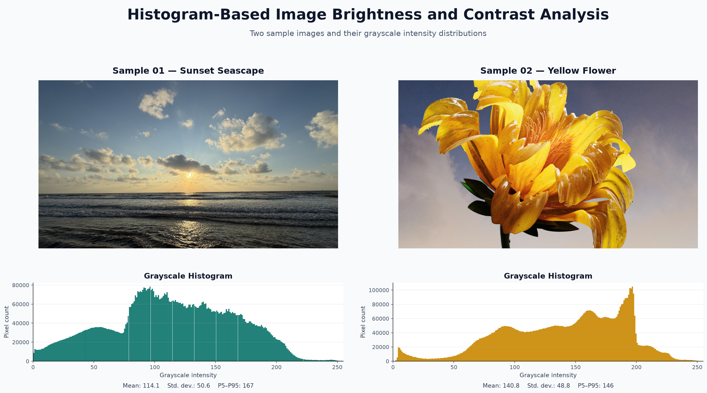

# Histogram-Based Image Brightness and Contrast Analysis

## Abstract

Digital images captured under insufficient or uneven illumination may suffer from poor brightness and low contrast, making visual details and object boundaries difficult to identify. This project proposes a histogram-based approach for analysing image brightness and contrast. For each input image, the system computes the grayscale histogram, mean gray level, and standard deviation to identify dark, overexposed, or low-contrast conditions. Gamma Correction and Contrast Stretching are then applied to improve image appearance according to the detected condition. The effectiveness of each enhancement method is evaluated by comparing image statistics, histograms, and Canny edge-detection results before and after processing. The expected outcome is a simple tool that recommends an appropriate enhancement method while showing whether the improved brightness and contrast also produce clearer and more meaningful edges.

**Keywords:** Image enhancement, histogram analysis, brightness, contrast, Gamma Correction, Contrast Stretching, Canny edge detection.

## Sample Visualization



## Quick Start: Single-Image Demo

Install the project dependencies, then process any local image. The command uses the
validated baseline rules: dark if mean gray `< 85`, low contrast if standard deviation
`< 45`, gamma `0.60`, and percentile stretch `2–98%`.

```powershell
pip install -e .
python scripts/process_image.py --input "C:\path\to\image.jpg" --output data\processed\demo
```

The input is never modified. The selected output directory receives:

- `<image>_enhanced.<ext>` — the enhanced image;
- `<image>_comparison.png` — original/enhanced images, grayscale histograms, and Canny edges;
- `<image>_metrics.json` — detected conditions, selected operation, configuration, and before/after measurements.

## Representative Sample-Set Result

The CLI was run with the baseline configuration on three deliberately different
samples from the local benchmark: one severely dark image, one controlled
low-contrast variant, and one normal-light control. This compact set exercises all
three expected decision paths without presenting the result as a full dataset claim.

| Sample | Input condition | Detected condition | Operation | Mean gray (before → after) | Robust range P98−P02 (before → after) | Entropy (before → after) | Edge density (before → after) |
| --- | --- | --- | --- | ---: | ---: | ---: | ---: |
| `LOL_LOW_03` | Underexposed | Dark + low contrast | `gamma+contrast_stretch` | 9.36 → 144.43 | 20 → 238 | 4.34 → 7.47 | 0.000% → 9.658% |
| `LCV_01` | Synthetic low contrast | Low contrast | `contrast_stretch` | 101.60 → 120.62 | 84 → 254 | 6.02 → 7.47 | 1.390% → 3.815% |
| `LOL_CTRL_01` | Normal-light control | Neither | `identity` | 95.03 → 95.03 | 216 → 216 | 7.49 → 7.49 | 5.216% → 5.216% |

### Interpretation

- `LOL_LOW_03` triggers both rules because its mean gray level and standard
  deviation are below the configured thresholds. Gamma correction first recovers
  shadow visibility; percentile stretching then broadens the tonal range. The large
  Canny increase indicates newly detectable intensity transitions, but it is an
  inspection signal—not proof that every new edge is meaningful rather than noise.
- `LCV_01` is a controlled contrast-reduction variant. It is not dark, so the system
  correctly skips gamma and applies only contrast stretching. Its higher dynamic
  range, entropy, and edge density are consistent with a histogram that has spread
  across more gray levels.
- `LOL_CTRL_01` remains unchanged. This is an important safeguard: the global rules
  avoid altering an image that is neither dark nor low contrast.

`LCV_01` is derived from a normal-light parent image and is included to test the
low-contrast rule in a controlled setting. The numbers above describe this sample
set only; visual comparison figures should be reviewed alongside them because edge
density and entropy alone are not universal image-quality metrics.

Reproduce the three outputs locally:

```powershell
python scripts/process_image.py --input data/benchmark/primary/LOL_LOW_03.png --output data/processed/representative/dark
python scripts/process_image.py --input data/benchmark/derived/LCV_01.png --output data/processed/representative/low_contrast
python scripts/process_image.py --input data/benchmark/primary/LOL_CTRL_01.png --output data/processed/representative/normal
```
